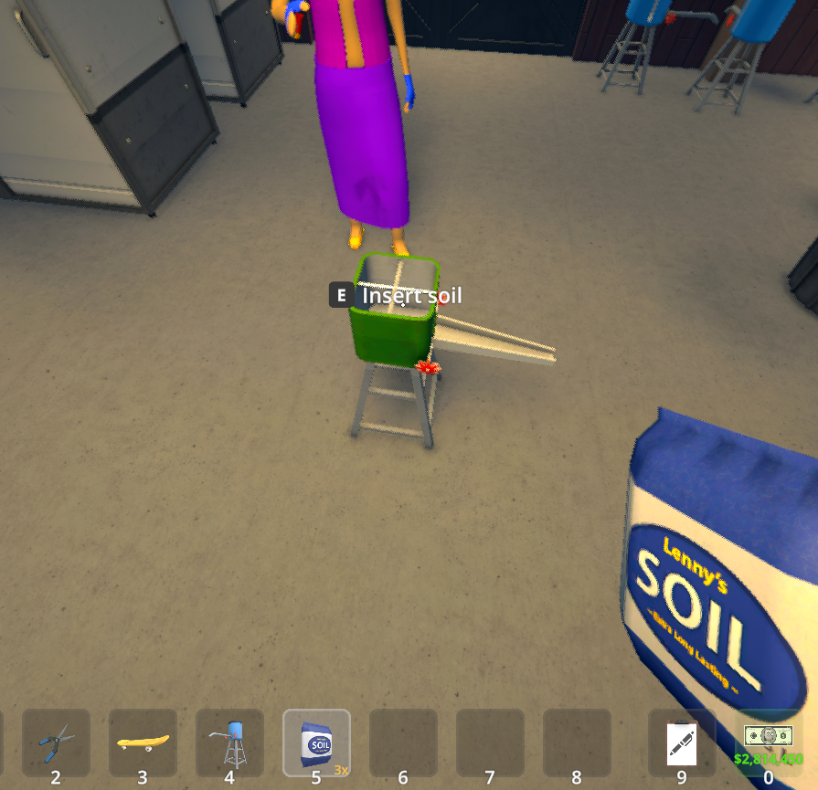
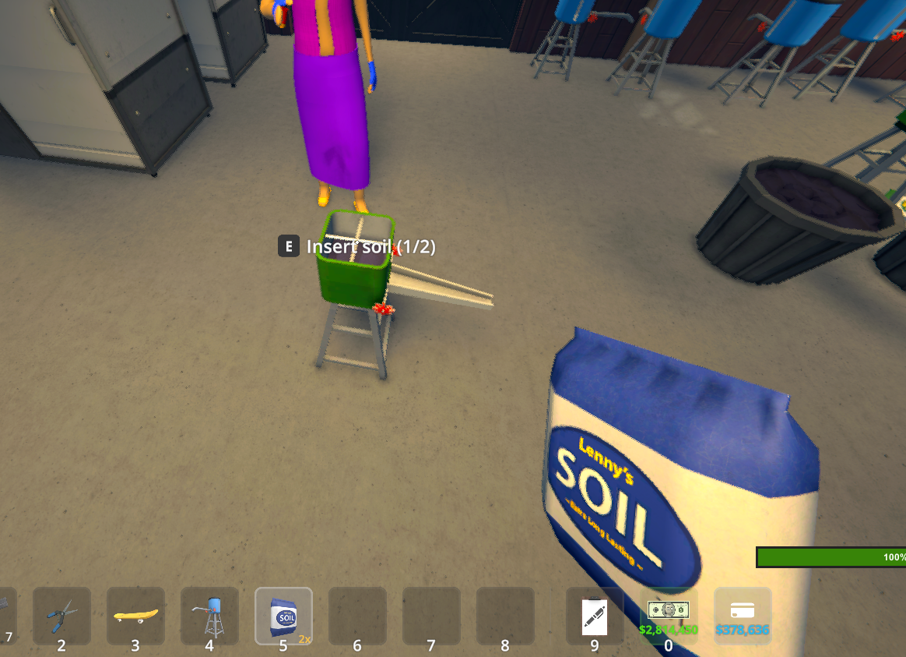
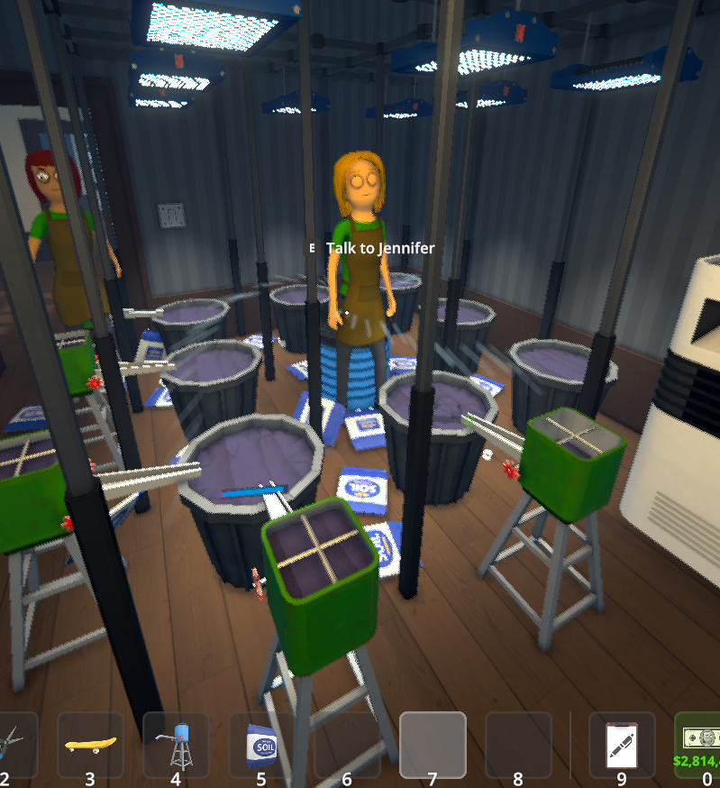
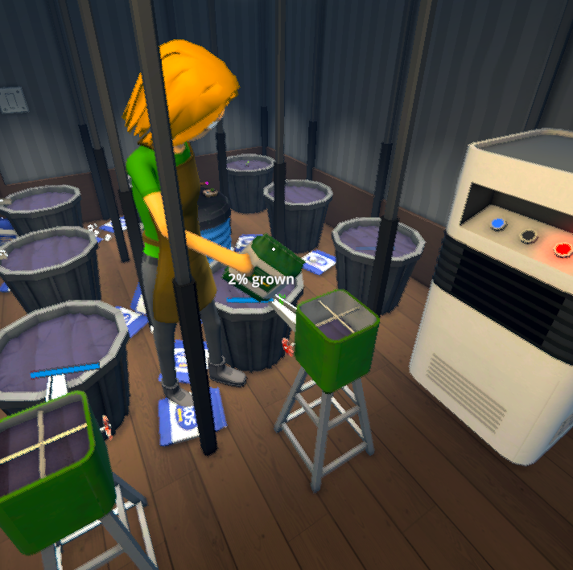

# Botanists Use X — Schedule I IL2CPP Ports

Modern IL2CPP ports of Fortis's Botanist Use Soil Pourer and Botanist Use Sprinkler mods, plus a combined configurable build:

- `BotanistUseSoilPourer.dll`
- `BotanistUseSprinkler.dll`
- `BotanistsUseX.dll`

These builds target Schedule I `0.4.7f12` IL2CPP and its replacement grow-container behavior API. The legacy mods patched the removed `PotActionBehaviour` type and therefore failed during Harmony initialization after the game update.

## Features

### Soil Pourer

- Finds a soil pourer through the device's authoritative linked-pot list.
- Gives each pourer a configurable capacity of 1–8 soil bags (2 by default).
- Lets players manually add matching soil bags until the pourer is full.
- Makes the visual soil level and interaction prompt reflect the stored charge count.
- Dispenses one charge at a time instead of emptying the entire pourer.
- Persists charge counts in `UserData/<mod-name>/soil-pourer-charges.json`.
- Makes botanists refill eligible pourers during idle work windows, including after completing their normal planting work.
- Routes refill trips to the pourer itself while preserving the normal first planting trip to the pot.
- When a loaded pourer is available, makes the botanist bring the configured seed, dispense soil, and plant immediately in one action.
- Preserves normal soil-bag consumption and trash creation when a botanist performs a refill.
- Falls back to the game's normal botanist behavior when no eligible pourer is linked.

### Sprinkler

- Supports both small and large sprinklers through their authoritative linked-pot lists.
- Activates a ready sprinkler instead of applying the botanist's normal hand-watering result.
- Skips the watering-can animation and releases the botanist to walk away after activation.
- Avoids duplicate watering assignments while a linked sprinkler is already active.
- Falls back to normal hand watering when no usable sprinkler is linked.

Gameplay changes are server-authoritative. Soil-pourer capacity, charge counts, refill changes, staged dispense events, fill prompts, and join-in-progress state are synchronized from the host to modded clients through the game's existing network APIs.

In multiplayer, every participant should install the same DLL and version. The host's configured soil-pourer capacity is authoritative for the session; a client's local capacity setting is used for their own games and temporarily replaced by the host value while connected.

Each build prints a blue-shaded `GSVS` identity banner during MelonLoader startup. The individual ports say `PORTED BY` and credit Fortis as the original author; the combined build says `CREATED BY` and credits the original Fortis concepts.

## Gameplay gallery

| Empty pourer ready for soil | One of two charges loaded |
| --- | --- |
|  |  |

| Botanists and linked grow equipment | Botanist using linked grow equipment |
| --- | --- |
|  |  |

## Choose one installation layout

Install either:

1. `BotanistsUseX.dll` for both features with independent toggles; or
2. Either or both individual DLLs.

Do not install the combined DLL alongside either individual DLL. Remove the legacy Fortis DLLs before installing these ports.

Copy the chosen DLL or DLLs into the game's `Mods` directory.


## Configuration

Configuration files are created on first launch under `UserData`.

Combined build (`UserData/BotanistsUseX/configuration.json`):

```json
{
  "soilPourerEnabled": true,
  "autoRefillSoilPourers": true,
  "soilPourerCapacity": 2,
  "allowManualMultiBagFill": true,
  "sprinklerEnabled": true,
  "debug": false
}
```

Individual builds use their existing-compatible directories:

- `UserData/BotanistUseSoilPourer/configuration.json` contains `enabled`, `autoRefillSoilPourers`, `soilPourerCapacity`, `allowManualMultiBagFill`, and `debug`.
- `UserData/BotanistUseSprinkler/configuration.json` contains `enabled` and `debug`.

Soil-pourer capacity is clamped to 1–8 bags. Successfully loaded configuration files are rewritten at startup so new options are added without requiring the user to delete an existing file.

## Build

Requirements:

- Windows PowerShell 7 or Windows PowerShell 5.1
- .NET 6 SDK
- Schedule I `0.4.7f12` IL2CPP with MelonLoader `0.7.0`

Build and statically verify all three DLLs:

```powershell
.\scripts\build-il2cpp.ps1 `
  -MelonLoaderRoot 'C:\Games\Schedule I\MelonLoader'
```

Create all three distributable archives:

```powershell
.\scripts\package.ps1 `
  -MelonLoaderRoot 'C:\Games\Schedule I\MelonLoader'
```

Outputs are written to ignored `bin/Il2Cpp` and `artifacts` directories.

## Compatibility status

- Mod version: `2.0.0`
- Schedule I: `0.4.7f12` (Steam public build `25796331`)
- Backend: IL2CPP
- Unity: `2022.3.62f2`
- MelonLoader: `0.7.0 Open-Beta`
- Mono/alternate branch: not currently supported
- Single-player: runtime verified
- Multiplayer host/client synchronization: runtime verified

See [docs/HANDOVER.md](docs/HANDOVER.md) for the exact build, hash, and runtime-verification record.

## Credits

The original Botanist Use Sprinkler and Botanist Use Soil Pourer concepts and legacy implementations were created by Fortis. The ports and combined build are maintained by GSVS UK ACM / xboxnuker-rgb.
